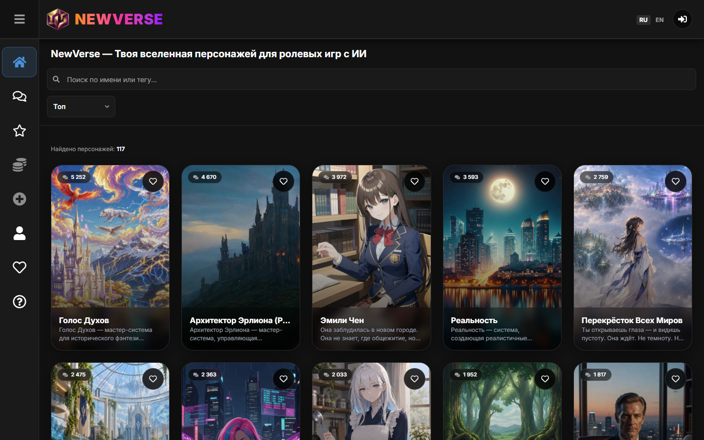
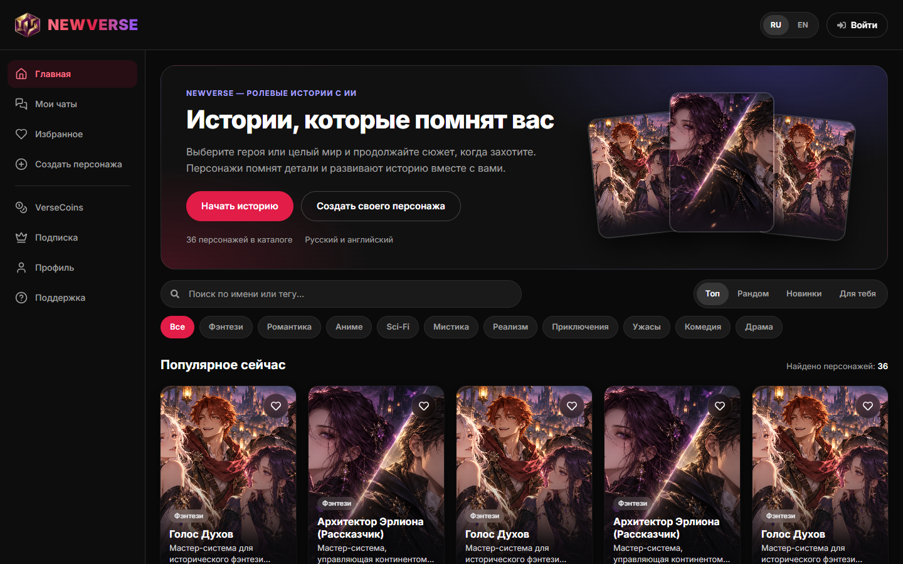
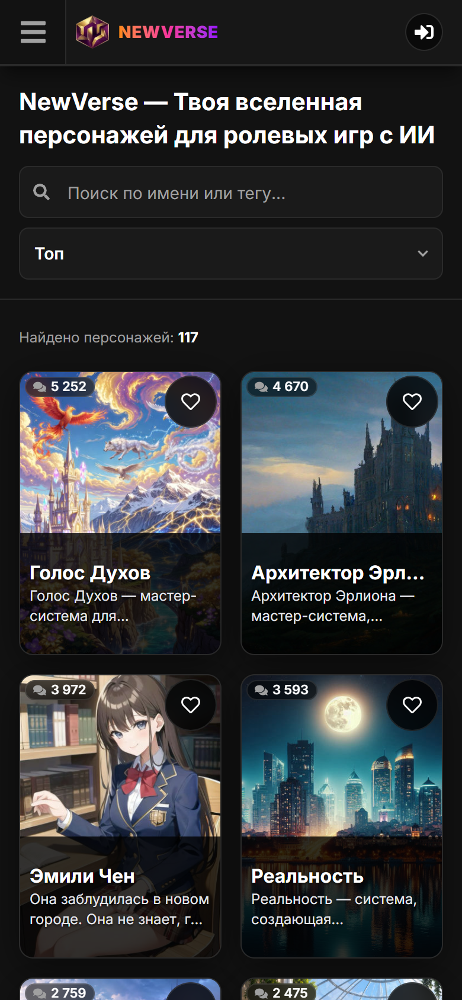
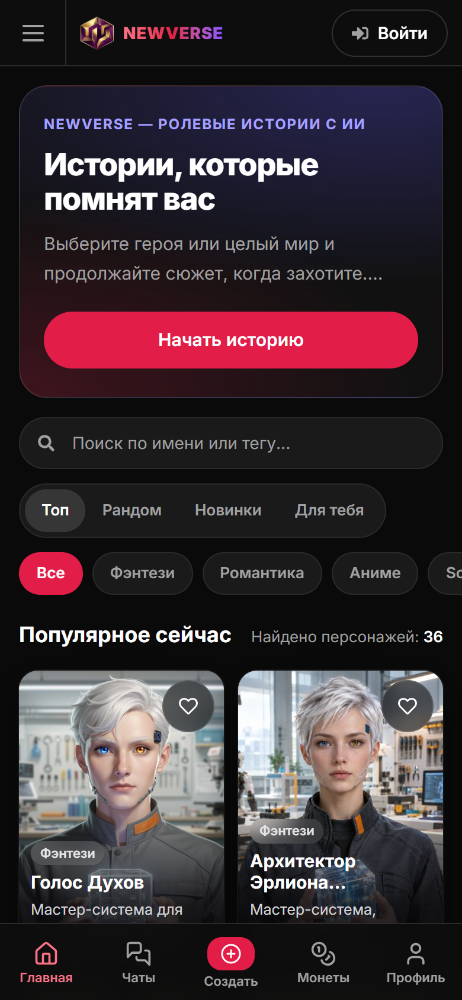
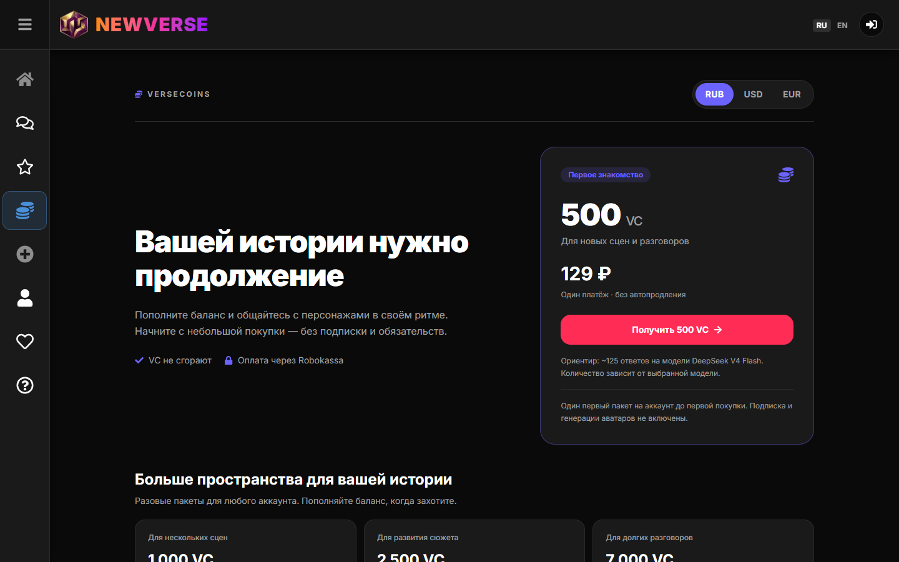
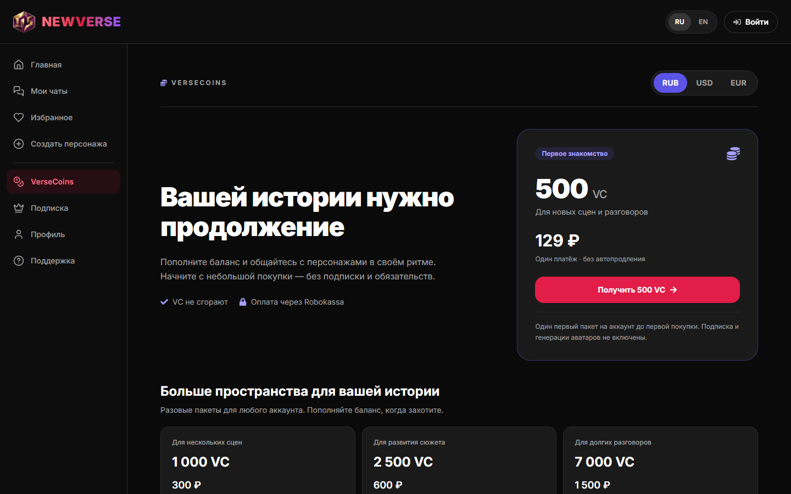

# Обновление стилистики NewVerse — 11.10.2026

Внедрена палитра A («роза + фиолет») и изменения из утверждённых макетов `docs/style-audit-2026-10-11/mockups.html`: единые цветовые токены, новое боковое меню, нижняя панель на мобильном, новая карточка каталога и главная для гостя. На момент первоначального отчёта коммит и деплой не выполнялись. Повторное ревью перед разрешённой владельцем выкладкой приведено ниже.

Проверено на локальной production-сборке с временной базой и синтетическими персонажами. SEO-проверка прошла полностью (94 проверки). На 19 экранах нет ни одного нарушения контраста WCAG, нет горизонтального скролла и ошибок JavaScript.

## Что было и что стало

Снимки «до» сделаны на newvers.ai, «после» — на локальной сборке. На снимках «после» имена и описания взяты у реальных персонажей, а картинки из тестового набора `docs/createya-paid-test-2026-10-07`, поэтому лица не совпадают с именами.

| До | После |
| --- | --- |
|  |  |
|  |  |
|  |  |

Остальные снимки «после» лежат в `docs/style-audit-2026-10-11/after/`: планшет 900 px, вход, подписка, создание, страница персонажа, чат, английская версия, главная для вошедшего пользователя.

## Что изменено

### Палитра и токены

- В `src/app/globals.css` заданы цвета палитры A. Основной цвет кнопок — `#E11D48` (белый текст 4,7:1 вместо прежних 3,65:1), наведение — `#BE123C`. Цвет монет и премиума — `#5B54E6` (белый текст 5,45:1 вместо 4,32:1).
- Добавлены отдельные оттенки для текста на тёмном фоне: `wd-primary-soft` (`#FB7185`) и `wd-secondary-text` (`#A5A0FF`). Они нужны, потому что цвета кнопок слишком тёмные для мелкого текста. Например, ссылка «Зарегистрироваться» в цвете `#E11D48` дала бы около 3,7:1.
- Темы оформления из `globals.css` (cyberpunk, emerald и другие) получили свой `--primary-soft`.
- 205 цветов, прописанных в компонентах напрямую, переведены на токены в 48 файлах. Это сделал скрипт `docs/style-audit-2026-10-11/migrate-colors.cjs`, его можно перезапустить с флагом `--dry`. Синий акцент меню `#4A90D9` убран полностью.
- Логотип перекрашен в ту же пару цветов: из светло-розового в розовый и фиолетовый.
- В манифесте `theme_color` совпадает с метатегом страницы (`#0A0A0A`), в неиспользуемом `tailwind.config.js` синхронизированы значения.
- Шрифт Inter теперь предзагружает и кириллицу (`subsets: ["latin", "cyrillic"]`). Кириллица и раньше отображалась Inter, но её файл грузился уже после рендера страницы.

### Навигация

- **Боковое меню на десктопе** (`Navbar.jsx`, `navItems.js`):
  - от 1024 px всегда показаны подписи, ширина 232 px; от 768 до 1023 px — полоса иконок с подсказками;
  - все иконки из одного контурного набора (Lucide), пункты разбиты на две группы;
  - активный пункт подсвечивается основным цветом.
- **Гамбургер на десктопе убран.** Ширина меню и отступ под шапку теперь задаются в CSS, а не выставляются JavaScript после загрузки. Раньше до гидратации контент на мгновение оказывался под шапкой.
- **Нижняя панель на мобильном** (`MobileBottomNav.jsx`): пять вкладок с подписями — Главная, Чаты, Создать, Монеты, Профиль.
  - Скрыта в чате, редакторах персонажа и админке, потому что там внизу своё поле ввода или кнопки.
  - Место под панель резервирует блок в потоке страницы. Всплывающие уведомления поднимаются над ней.
- **Шапка.** Гость видит текстовую кнопку «Войти» вместо круглой иконки. Переключатель RU/EN стал «таблеткой» высотой 32 px вместо 20, а на мобильном переехал в низ выдвижного меню.

### Каталог и главная

- **Карточка** (`CharacterCard.tsx`):
  - одна пропорция 2:3 и скругление 16 px на всех экранах;
  - мягкий градиент вместо плашки с резкой границей;
  - имя до двух строк, описание 13 px;
  - повтор имени в начале описания убирается автоматически (`stripLeadingName`);
  - жанровый тег и счётчик сообщений с правильными окончаниями («5 252 сообщения», «4 670 сообщений»).
- **Серверная выдача.** `getPublicCatalog` отдаёт теги, поэтому жанр на карточке виден и без JavaScript.
- **Фильтры** (`CharacterSearchFilters.tsx`):
  - поиск в форме «таблетки» с кнопкой очистки;
  - сортировка — переключатель из четырёх кнопок вместо выпадающего списка;
  - ряд из десяти жанровых чипов. Клик по чипу ищет по тегу, адрес страницы обновляется как раньше (`?q=`).
- **Вводный блок для гостей** (`HomeHero.jsx`).
  - Сервер показывает его только гостю на первой странице без поиска, поэтому вошедшие пользователи его не видят и он не мелькает при загрузке.
  - H1 содержит прежние ключевые слова: «NewVerse — ролевые истории с ИИ. Истории, которые помнят вас». У вошедшего пользователя остаётся прежний H1.
- Заголовок раздела зависит от сортировки: «Популярное сейчас», «Новинки», «Подборка для вас», «Результаты поиска».

### Мелочи

- «УПРАВЛЕНИЕ ПОДПИСКОЙ» и «ДОСТУПНЫЕ ТАРИФЫ» набраны обычным регистром. Корона на странице подписки больше не полупрозрачная.
- Бейдж «Популярный» увеличен с 9 до 11 px, подписи статистики в профиле — с 9 до 11 px.
- Тег «Цуцере» исправлен на «Цундере». Старое написание оставлено синонимом в `parseTagsString`: иначе `normalizeTagsString` выбросил бы тег у существующих персонажей при следующем сохранении.

## Проверка

- `tsc --noEmit` проходит, `npm run build` проходит. Все новые классы Tailwind есть в собранном CSS.
- Полный ESLint по всем изменённым JS/TS-файлам: 14 ошибок и 23 предупреждения. Все 14 ошибок уже есть на исходном `HEAD` (`8ef2b44`); сравнение по каждому файлу и правилу не выявило новых ошибок. Первоначальная проверка только основных компонентов показывала две ошибки в `Navbar.jsx` и `SidebarContext.jsx` и не охватывала остальные файлы.
- `npm run verify:seo:runtime` — 94 проверки пройдены: H1 в серверном HTML, ссылки на персонажей без JavaScript, пагинация, поиск, канонические адреса, отсутствие ошибок гидратации.
  - В тесте выбор сортировки переписан на кнопку вместо выпадающего списка.
  - После итоговой строки скрипт завис на остановке временного Postgres в Windows, и его пришлось завершить вручную. На результат проверок это не влияет.
- `docs/style-audit-2026-10-11/preview-after.mjs` прогоняет 9 маршрутов на ширине 1440 и 390 px, главную ещё на 900 px. Он использует ту же изоляцию, что и SEO-тест: отдельный Postgres, без `.env`, внешние запросы блокируются. Результат:
  - нарушений контраста — 0 (на живом сайте до изменений: 14 на странице монет, по одному на главной, входе, подписке и странице персонажа);
  - горизонтального скролла и ошибок страниц нет;
  - нижняя панель видна только на мобильном и скрыта в чате.

Повторить проверку: `npm run build`, затем `node docs/style-audit-2026-10-11/preview-after.mjs`.

### Повторное ревью перед выкладкой

- Реализация палитры, навигации, гостевого блока, фильтров, карточек и SSR-тегов соответствует описанию. Изменений тарифов, провайдеров AI или схемы БД в этой выкладке нет.
- Повторно прошли `tsc --noEmit`, production-сборка с синтетическими переменными, 94 HTTP/DB/browser-проверки SEO и 118 проверок безопасности, включая сканирование кандидатов в коммит. Локальная сборка не подключалась к production-БД.
- `verify:editor:browser` обновлён под постоянное меню 232 px и планшетную полосу 80 px: 31 сценарий пройден. Проверены выбор трёх типов, клавиатурная навигация, мобильное меню, создание и редактирование группы из восьми участников. Ответы API подставные, платные запросы не выполнялись.
- Независимый просмотр: 22 сочетания страницы и экрана (1440/900/390/320 px), без ошибок JavaScript и горизонтального переполнения. Проверка контраста на распознаваемых сплошных фонах проходит; текст поверх изображений и градиентов алгоритм пропускает, поэтому это не подтверждение полной WCAG-совместимости.
- Скрипт просмотра теперь использует изображения из `public/images/roleplay-modes-v1`, не требует отдельного набора платных тестов и завершает выполнение с ошибкой при нарушении проверяемых условий. Для независимых снимков можно указать `STYLE_PREVIEW_OUTPUT`. Исходные снимки в отчёте сохранены.
- Полная проверка ESLint: 14 прежних ошибок, новых ошибок относительно `8ef2b44` нет. Старые ошибки не мешают сборке, но остаются отдельным техническим долгом.
- Коммит и push редизайна разрешены владельцем. После push нужно подтвердить новый HTML и CSS на `newvers.ai`; миграция и новые переменные не требуются.

## Отличия от макетов

- **Гамбургер на мобильном оставлен.** Нижняя панель вмещает 5 пунктов, а «Избранное», «Подписка» и «Поддержка» доступны только из выдвижного меню. Кроме того, в чате нижней панели нет, и без гамбургера там не было бы доступа к меню.
- **Поиск остался над каталогом, а не в шапке.** Поиск в шапке потребовал бы отдельного перехода на главную с каждой страницы.
- **Блок «500 VC за 129 ₽» в боковом меню не сделан.** Цена зависит от валюты и условий первой покупки, а прописать её в меню напрямую — риск показать неверную сумму.
- **Счётчик в вводном блоке** показывает число персонажей в каталоге вместо «первый пакет — 129 ₽», по той же причине.

## Что осталось

- **Плашка подтверждения почты.** Она закреплена поверх контента (`fixed`) и у пользователя с неподтверждённой почтой закрывает верх страницы, включая H1 главной. Так было и до изменений. Простой перенос в поток страницы ломает чат с фиксированной высотой, поэтому нужно отдельное решение.
- **Нейтральные серые** (`#2A2A2A`, `#1A1A1A`, `#121212`, `#0A0A0A`, `#A0A0A0`) по-прежнему прописаны в компонентах напрямую, около 200 мест. Визуально это ничего не меняет, но альтернативные темы их не перекрасят.
- **Страница персонажа** осталась модальным окном без тегов, приветствия и похожих персонажей: макета для неё не было.
- **Персонажи с тегом «Цуцере» в базе.** Тег будет исправлен у каждого при следующем сохранении в редакторе, массовой миграции не было. Поиск по чипу не ищет по старому написанию, но оно не входит в список жанров.
- **Не проверено вручную:** вход через Google (в изолированной сборке нет ключей) и реальные аватары production. Браузерный тест редактора `verify:editor:browser` повторно пройден: 31 проверка. В редакторах менялись только цвета.

## Материалы

- `docs/style-audit-2026-10-11/mockups.html`, `mockups/` — утверждённые макеты.
- `docs/style-audit-2026-10-11/shots/`, `observations.json` — снимки и замеры живого сайта до изменений.
- `docs/style-audit-2026-10-11/after/` — снимки после изменений.
- `docs/style-audit-2026-10-11/migrate-colors.cjs` — скрипт замены цветов.
- `docs/style-audit-2026-10-11/preview-after.mjs` — скрипт предпросмотра на изолированной сборке.
